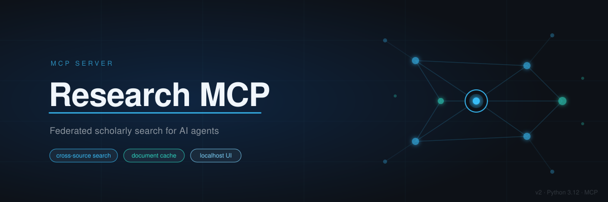

# Research MCP v2

A personal MCP server for macOS that gives Claude Code, Claude desktop, Codex, and OpenClaw agents one unified interface to many scholarly databases. A single call fans out across sources, merges and deduplicates results, and returns them with per-source status. Fetched documents are cached for 120 days, then reviewed and archived to Google Drive where they stay searchable. A localhost web UI and macOS notifications surface source health and credential expiry.

v2 is a clean rebuild of v1 (`my-research-mcp-server`), which stays read-only until cutover.

[](https://www.python.org/)
[](https://developer.mozilla.org/en-US/docs/Web/JavaScript)
[](https://www.sqlite.org/)
[](https://www.gnu.org/software/bash/)
[](LICENSE)

## Build status

Milestone M0 is in progress. Core, platform (HTTP client, secrets, stores, logging, rate limits, downloader), three source adapters (arXiv, Crossref, OpenAlex), federated search, and the MCP app are built. The daemon process, cache lifecycle, health monitoring, local UI, and migration from v1 are planned for M1 through M4.

## What it does

An agent calls one tool, `search`, with a query. The server fans the query out to every configured scholarly source in parallel, applies per-source timeouts and an overall deadline, normalizes each result into a `WorkRecord`, groups records by shared identifiers (DOI, arXiv ID, OpenAlex ID, and others), merges duplicates, and returns ranked results with a per-source status list. If a source is down, slow, or over quota, the others still answer.

Once a paper is of interest, `fetch` downloads its open-access PDF safely, extracts and chunks the text in a worker subprocess, embeds the chunks, and stores everything in a local SQLite cache. `read` returns bounded windows of the document. `get_work` resolves any identifier, merges metadata from all sources that know the paper, and reports open-access locations and cache state.

At 120 days the owner gets a macOS notification. The review UI shows expiring papers; the owner archives (copies to Google Drive, keeps text searchable in the local cache) or discards (7-day trash before purge). Archived papers remain findable through their text and embeddings.

## Architecture

```
 +------------------+   +------------------+   +------------------+
 | Claude Code      |   | Claude desktop   |   | Codex, OpenClaw  |
 | (MCP client)     |   | (MCP client)     |   | agents           |
 +--------+---------+   +--------+---------+   +--------+---------+
          | stdio                 | stdio                 | stdio / HTTP
          v                       v                       v
 +----------------------------------------------------------------------+
 | research-mcp shim (one per client, stateless)                         |
 +-----------------------------------+----------------------------------+
                                     | streamable HTTP, 127.0.0.1, bearer token
                                     v
 +----------------------------------------------------------------------+
 | research-mcpd (one daemon per Mac, launchd KeepAlive)                 |
 |  MCP /mcp  |  UI /ui  |  /healthz  /readyz  /api/status               |
 |  federation, works, cache, health, notifications, jobs, scheduler     |
 |  source registry (42+ adapters planned)  |  shared async HTTP client  |
 |  state.db  |  cache.db (FTS5, vectors)  |  worker subprocesses        |
 +---+-------------+-----------------+-----------------+----------------+
     |             |                 |                 |
     v             v                 v                 v
 Upstream APIs  macOS Keychain   Google Drive      macOS notifications
 (arXiv,        (secrets,        sync folder       + OpenClaw webhook
 OpenAlex,       read-only)      (archive)
 Crossref, ...)
```

The daemon is one Python process built in strict layers:

| Layer | Modules | Responsibility |
|---|---|---|
| core | ids, models, errors, envelope, timeutil | Pure functions, no I/O |
| platform | http, secrets, stores, logging, ratelimit, redact, download, workers | I/O primitives and infrastructure |
| sources | base (SourceSpec), registry, one module per source | Translate only; no HTTP calls inside adapters |
| services | federation, works, cache, health, notifications, jobs, scheduler | Business logic |
| transport | mcp_app (tools, resources, prompts), ui (pages), http_api | Thin handlers over services |

Rules enforced throughout:

- Adapters only translate; they never make HTTP calls, sleep, read secrets, or write files.
- No tool may block the event loop. CPU work (PDF extraction, chunking, embedding) runs in a short-lived worker subprocess with CPU, memory, and time limits.
- Secrets live in the macOS Keychain; configuration holds only references. Nothing writes a secret to a log, error, tool result, UI page, or notification.
- All downstream content is labeled untrusted; no free-form SQL over it.
- The downloader is HTTPS-only, resolves to public IPs, pins the connection to the checked IP, caps bytes, and verifies magic bytes before writing atomically.

## Technology

| Concern | Choice |
|---|---|
| Language | Python 3.12, managed by uv |
| Package layout | src/ layout, package `research_mcp`, version 3.0.0 |
| Async runtime | anyio |
| HTTP client | httpx with HTTP/2 |
| Data layer | Two SQLite (WAL) files via aiosqlite; FTS5 for full-text; vectors as BLOBs |
| Models | Pydantic v2; mypy strict on src/ |
| Web framework | Starlette + Jinja2 + htmx (vendored, localhost UI only) |
| Secrets | macOS Keychain via /usr/bin/security |
| PDF processing | PyMuPDF (optional), in a worker subprocess |
| Embeddings | fastembed + numpy (optional), in a worker subprocess |
| Row IDs | ULIDs for works, documents, jobs, and review batches |
| Time | UTC everywhere, stored as ISO 8601; scheduler converts to local time |
| Testing | pytest with --import-mode=importlib; network blocked by default; recorded fixtures |
| Linting | ruff (E, F, I, W, B, UP, SIM, ASYNC, BLE, S, C90) |
| Type checking | mypy strict |
| Process management | launchd KeepAlive; watchdog every 15 minutes; doctor daily |

## Setup

### Requirements

- macOS (Keychain and launchd integration)
- Python 3.12 or later
- [uv](https://docs.astral.sh/uv/) 0.4 or later
- Claude Code or another MCP client

### Development install (M0)

```bash
git clone https://github.com/khillerkb/research-mcp.git
cd research-mcp
uv sync --frozen
```

Run the full check suite:

```bash
tools/ci.sh --python-only
```

This runs ruff, mypy, pytest (network blocked by default), and the SDD spec and trace checks.

### Full install (planned, later milestones)

Once the daemon and CLI are complete, the install will be:

```bash
uv tool install research-mcp[pdf,embeddings,macos]
research-mcp install
```

`research-mcp install` will write three launchd agents (`research-mcpd` with KeepAlive, a 15-minute watchdog, and a daily doctor), create application support folders, generate the daemon bearer token in the Keychain, perform the first Google Drive archive write (triggering the macOS privacy prompt), and print the MCP client configuration to add to your client.

### Configure sources

Sources are configured in `~/.config/research-mcp/config.toml`. Sources that require API keys hold a Keychain reference, not the value:

```toml
[sources.github]
enabled = true
token_keychain = "research-mcp/GITHUB_TOKEN"

# Web search is off by default. It is never included in the default fan-out,
# runs in fallback order (one paid query per page), and is capped per day.
[sources.web]
enabled = false
```

Topic coverage and docs-site instances are configuration, not code. A `site_set` is a named list of domains passed as a filter to any web-search source.

## Usage

### Connect a client

After install, add the shim to your MCP client configuration. For Claude Code, in `.claude/settings.json`:

```json
{
  "mcpServers": {
    "research": {
      "command": "research-mcp",
      "args": ["stdio"]
    }
  }
}
```

### MCP tools (M0, built)

| Tool | Description |
|---|---|
| `search` | Fan-out search across configured sources; returns merged, ranked works with per-source status |
| `get_work` | Resolve any identifier (DOI, arXiv ID, OpenAlex ID) across all sources that know it |
| `list_sources` | List registered sources with health and capability flags |

### MCP tools (planned)

| Tool | Milestone | Description |
|---|---|---|
| `fetch` | M2 | Download and cache a paper by identifier or URL |
| `read` | M2 | Read bounded windows of a cached document |
| `get_citations` | M1 | Citations and references for a work |
| `search_local` | M2 | Hybrid FTS + vector search over the local cache |
| `cite` | M1 | Generate a formatted citation |

### Sources

Three adapters ship in M0: arXiv, Crossref, and OpenAlex. The full source set planned for M1 covers approximately 42 sources including Semantic Scholar, CORE, PubMed, DBLP, SSRN, bioRxiv, four DSpace institutional repositories, documentation sites (AWS, Microsoft Learn, GCP), and optional metered web-search providers.

## Documents

The project follows spec-driven development. Every design decision has a numbered ADR; every requirement has a stable ID that traces from the vision through the PRD, SPEC, LLD, test plan, and code.

| Document | Role |
|---|---|
| [Vision v2](docs/vision/vision-v2.md) | Why, for whom, outcomes |
| [PRD v8](docs/prd/PRD-v8.md) | Requirements, NFRs, invariants, milestones |
| [Component PRDs](docs/prd/components/) | Per-component requirements and acceptance criteria |
| [SPEC v5](docs/spec/SPEC-v5.md) | System high-level design |
| [LLDs](docs/lld/) | Build contracts: names, interfaces, schemas, behavior |
| [Test plan v4](docs/test/test-plan-v4.md) | How each criterion is verified; exit gates |
| [M0 plan v4](docs/build/M0-plan-v4.md) | Work units and dependencies for milestone 0 |
| [ADRs](docs/adr/) | Architecture decisions |
| [Doc map](docs/README.md) | Index of all documents with status |

## Development

```bash
uv sync --frozen                      # install dependencies
tools/ci.sh --python-only             # lint, types, tests, SDD checks (must stay green)
uv run pytest -q                      # tests only
uv run pytest -m live -q              # opt-in live tests (real API access required)
node tools/sdd/cli.mjs check          # spec-lint and trace-check
node tools/sdd/cli.mjs docmap         # regenerate the doc map
```

Every test cites the criterion it verifies in its docstring (`@spec PLAT-31: ...`). The entry point of each behavior in code carries a matching `# @spec PLAT-31` comment. Network is blocked in all tests except those marked `live`.

## Security

The full threat model is in [PRD-security-v1](docs/prd/components/PRD-security-v1.md) and [SPEC section 9](docs/spec/SPEC-v5.md). A summary of the controls:

- Secrets never leave the Keychain except as HTTP headers scoped to their origin.
- A redaction filter strips registered secrets from logs, errors, the UI, and notifications.
- No free-form SQL accepts untrusted content; fetched text is enveloped and labeled untrusted.
- PDF parsing runs in a sandboxed subprocess with CPU, memory, page, and time limits; a crash affects only that document.
- The downloader accepts only HTTPS, resolves to public IPs, pins the connection, and caps bytes before an atomic write.
- MCP discards require an explicit owner decision, go to a 7-day trash, and trigger an owner notification before any permanent purge.
- Web-search sources are off by default and capped per day.

## License

MIT
